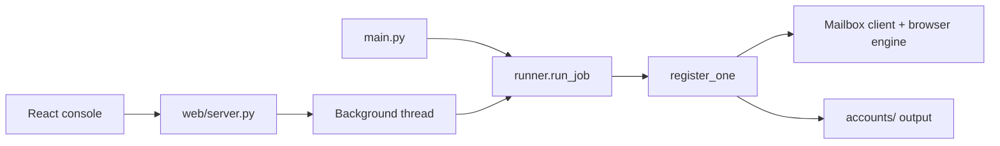

# Repository Guidelines

## Project Overview

GitHub Register automates authorized GitHub signup and mailbox verification, with optional repository creation, TOTP setup, profile completion, and CodeBuddy/Qoder integrations. It exposes a Python CLI and a local React web console. Live workflows create accounts and persist credentials; do not use them as routine smoke tests.

## Architecture & Data Flow



- `github_register/runner.py` owns batch execution, signup, retries, and post-signup stages. `engines.py` supplies context-managed browser adapters; `mailcx.py`, `litensi.py`, `cloudflare.py`, and `tempik.py` supply mail providers. An explicit engine is exclusive; otherwise `engine_order` controls fallback. Reuse the mailbox across engine attempts and keep the proxy pinned for each account.
- FastAPI exposes job/config/account APIs and serves `frontend/dist`. Job state, auth sessions, and log buffers are process-local and lock-protected; retain the single-worker server model. Registration, CodeBuddy, and Qoder have separate job lanes.
- The console polls status and streams logs over SSE. `frontend/src/api.js` supplies authenticated fetch requests using `X-Access-Key`, with the token in localStorage. Server restarts invalidate sessions.
- Persistence is file-based, not a database: account records, recovery codes, session cookies, and groups live under `accounts/`. Treat the `email----password----username----totp_secret----has_recovery` record format as a shared contract between runner, API parsers, and CodeBuddy bridge.

## Key Directories

- `github_register/`: orchestration, browser engines, mailbox clients, profile helpers, and integration flows.
- `web/`: FastAPI control plane, authentication, background job state, and file APIs.
- `frontend/src/components/`: feature panels and shared `ui.jsx` primitives; shell/auth in `App.jsx`, transport in `api.js`.
- `codebuddy_login/`: vendored Node OAuth/token workflow called by the Python bridge; separate npm dependencies and operational notes.
- `tests/`: offline Python self-checks. `accounts/` is sensitive runtime output, not test data.

## Development Commands

Run from the repository root unless indicated. Activate the virtualenv before Python commands.

```bash
python3 -m venv .venv
source .venv/bin/activate
pip install -r requirements.txt
python -m camoufox fetch
patchright install chromium
```

Copy `config.example.json` and `.env.example` to local `config.json` and `.env` only when absent; never overwrite existing credentials.

```bash
# Build the console, then serve the build and API on 127.0.0.1:8093
(cd frontend && npm ci && npm run build)
python -m web.server

# Alternative: frontend hot reload on 5173, backend still needed on 8093
(cd frontend && npm run dev)

# CLI discovery; an actual run creates accounts
python main.py --help
python main.py --config config.json --count 1 --headless

# Offline checks
python -m tests.test_core
python -m tests.test_codebuddy
```

No lint/format command is configured. `docker compose up -d --build` requires the external `nginx-network` and pre-existing bind-mounted files listed in `docker-compose.yml`; it does not publish a host port.

## Code Conventions & Common Patterns

- Python uses four-space indentation, snake_case functions, PascalCase classes, annotations, and dataclass `Config`. Follow the touched file's style; JSX formatting varies between files, with no enforced formatter.
- Browser and mailbox work is synchronous. Keep blocking automation in job threads, not the FastAPI event loop. Dependency injection is via `log`, `cancel_cb`, and `progress_cb` callables, not a container. Propagate cooperative cancellation through waits and polling.
- Preserve error classification: `MailboxTimeoutError` fails one account; fatal provider/configuration errors abort the batch. `MailboxCancelled` must remain distinct from provider errors. Do not replace these distinctions with broad exception swallowing.
- React uses function components, hooks, props, and local state rather than a router or global store. Reuse `api.js`, shared `ui.jsx` controls, and existing CSS classes; clean up timers and subscriptions in effects.
- For new configuration fields, check `Config`, `config.example.json`, server `ConfigBody`/secret masking, and `ConfigPanel.jsx` together. Unknown JSON keys are silently dropped by `Config.from_dict`.
- Preserve local secrets and generated output. Do not read, log, or commit `.env`, real config/proxy files or their backups, account/session/recovery data, browser profiles, trust cookies, or CodeBuddy tokens. Use example files and synthetic fixtures.

## Important Files

- `main.py`, `web/server.py`, `frontend/src/main.jsx`: CLI, server, and UI entry points.
- `github_register/config.py`, `dotenv.py`, `engines.py`, `mail_errors.py`: configuration, environment loading, browser registry, and shared failure semantics.
- `github_register/codebuddy_flow.py`, `qoder_flow.py`, `qoder_inject.py`: integration orchestration; CodeBuddy invokes `codebuddy_login/github-login.js`.
- `README.md`: installation/operations; `DESIGN.md`: frontend style reference; `codebuddy_login/UPSTREAM_README.md`: fork-specific integration notes.
- `proxy_rotator.py`, `record_camoufox.py`, `retry_qoder.sh`: live operational tools, not QA. Proxy disabling rewrites the pool; the retry script contains a machine-specific absolute path.

## Runtime/Tooling Preferences

- README requires Python 3.11+ and Node.js 18+; Docker uses Python 3.12 and Node 20. Use pip/venv and npm lockfiles; Bun is not the repository toolchain.
- Python dependencies are minimum-version requirements, not a locked environment. Browser binaries require separate installation; external browser engines may require additional services, keys, or executables.
- Existing process environment wins over `.env`. Application settings come from `config.json`; CLI flags and web per-run overrides take precedence for that run. Compose's explicit `environment` values override its `env_file`.
- Default backend binding is loopback. Configure console authentication before external exposure; enable `GITHUB_REGISTER_TRUST_PROXY` only behind a trusted reverse proxy.

## Testing & QA

- Python tests use plain `assert` functions and module-level self-runners, not a required pytest/unittest framework. Restore directly patched attributes in `finally`; use temporary directories and offline provider stubs. Extend these checks for behavior changes, especially cancellation, error classification, fallback, and account parsing.
- No coverage threshold or configured coverage gate exists. Passing offline checks does not prove live browser/provider integrations.
- UI QA: build the frontend and run the backend, install Chromium with `(cd frontend && npx playwright install chromium)`, then run `npm run verify:ui` and `npm run verify:clicks` inside `frontend/`. Both target `http://127.0.0.1:8093` by default; `BASE` overrides it. They check responsive layout/accessibility and click behavior. Use a disposable setup: clicks can call live provider APIs, and an auth-enabled server requires login handling.
